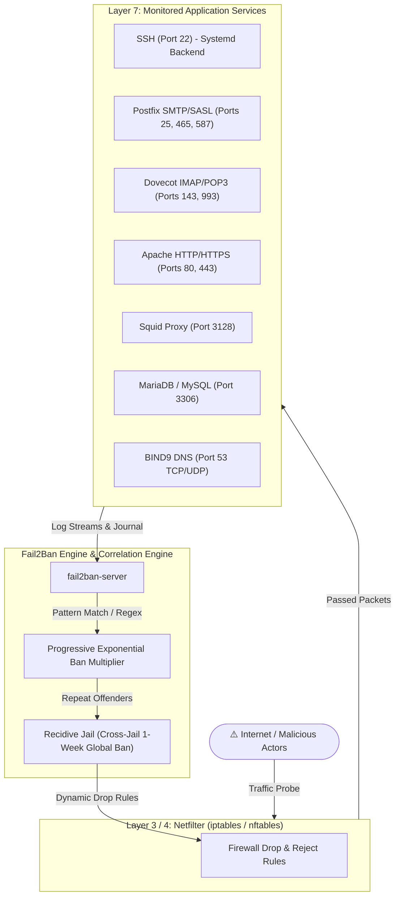

<div align="center">

# 🛡️ Fail2Ban Hardened Security Suite

**Enterprise-Grade Multi-Layer Intrusion Prevention System (IPS) for Linux Servers**

[](https://github.com/arthas95/fail2ban-security-suite/actions/workflows/lint-and-test.yml)
[](https://www.fail2ban.org/)
[](LICENSE)
[](#)
[](https://github.com/arthas95)

</div>

---

## 📌 Overview

**Fail2Ban Security Suite** is a production-hardened, modular intrusion defense configuration designed to protect Linux servers against real-world attack vectors, including automated botnets, credential stuffers, web vulnerability scanners, mail relays, and DNS amplification attacks.

Standard Fail2Ban installations often monitor only SSH with lenient 10-minute bans. This repository provides an end-to-end multi-tier defense architecture covering all critical exposed services with progressive exponential backoff banning, zero false-positive tuning, and cross-jail recidivism protection.

---

## 🏗️ Multi-Layer Defense Architecture



---

## 🛡️ Monitored Services & Jail Matrix

| Jail Name | Target Service | Ports | Monitored Logs / Backend | Attack Signatures Mitigated | Default Ban |
|:---|:---|:---:|:---|:---|:---:|
| `sshd` | OpenSSH | `22` | `systemd` journal | Brute-force password guessing, invalid SSH protocol abuse | 1h (Exponential) |
| `postfix` | Postfix Mail | `25, 465, 587` | `/var/log/mail.log` | SASL auth brute-force, unauthorized relaying, spoofed HELO/EHLO | 1h (Exponential) |
| `dovecot` | Dovecot IMAP/POP3 | `143, 993` | `/var/log/mail.log` | Mailbox brute-force, dictionary attacks, invalid command flood | 1h (Exponential) |
| `apache-auth` | Apache Web | `80, 443` | `/var/log/apache2/*error.log` | HTTP Basic Auth failures, server forbidden access | 1h (Exponential) |
| `apache-badbots`| Apache Web | `80, 443` | `/var/log/apache2/*access.log` | Vulnerability scanners, aggressive web spiders, automated scrapers | 24h |
| `apache-scanners` | Apache Web | `80, 443` | `/var/log/apache2/*access.log`<br>`/var/log/apache2/*error.log` | Probing for `.env`, `.git`, AWS credentials, phpinfo, CGI path traversal (`AH10244`) | 24h |
| `squid-proxy` | Squid HTTP Proxy | `3128` | `/var/log/squid/access.log` | Open-proxy abuse (`TCP_DENIED/403`), malformed proxy requests (`NONE_NONE/400`) | 24h |
| `mariadb-auth` | MariaDB / MySQL | `3306` | `systemd` (`mariadb.service`) | Unauthorized root/user access attempts, credential brute-forcing | 2h (Exponential) |
| `named-refused` | BIND9 DNS | `53` (tcp/udp) | `/var/log/syslog` | DNS amplification probes, recursive resolver cache refusals, AXFR zone transfers | 6h |
| `recidive` | **All Services** | **ALL** | `/var/log/fail2ban.log` | Repeat offenders who trigger bans across multiple jails (banned across all ports) | **1 Week** |

---

## ⚡ Key Hardening Features

### 1. Progressive Exponential Ban Time (`bantime.increment`)
Rather than relying on fixed ban intervals that allow attackers to wait and retry indefinitely, this stack uses Fail2Ban's geometric progression:
- **1st ban:** 1 Hour
- **2nd ban:** 2 Hours
- **3rd ban:** 4 Hours
- **4th ban:** 8 Hours
- **Persistent attackers:** up to 4 Weeks (`bantime.maxtime = 4w`)
- **Anti-timing jitter:** Introduces timing entropy (`bantime.rndtime`) to prevent attackers from predicting exact unban moments.

### 2. Zero False-Positive Health Check Handling
Monitoring systems (e.g. UptimeRobot, StatusCake, Pingdom) perform frequent synthetic TCP handshakes to verify service health on port 25. Standard aggressive Postfix filters frequently mistake these for DoS attempts (`lost connection after CONNECT`). This suite implements dedicated `mode = extra` tuning and `ignoreregex` filters so external health monitoring never causes an accidental ban.

### 3. Custom Application Probing & Exploit Filters
- **Web Sensitive Files:** Detects automated reconnaissance tools scanning for environment files (`.env`, `.env.production`), version control directories (`.git`), cloud credentials (`/config/aws.yml`), database dump files, and web shells.
- **Path Traversal & CGI Exploits:** Detects directory traversal patterns (e.g., CVE-2021-41773 Apache `%%32%65` traversal) directly from the Apache core error logs (`AH10244`).
- **Squid Proxy Defense:** Blocks internet crawlers attempting to utilize private Squid instances as open relay proxies.

---

## 🚀 Quick Start / Deployment

> 🇫🇷 **En français :** Un guide direct est disponible dans [MODE_D_EMPLOI.md](MODE_D_EMPLOI.md).

### 1. Prerequisites (Fresh Debian / Ubuntu)
On minimal Debian installations, ensure `git` is installed:
```bash
apt update && apt install -y git
# or with sudo: sudo apt update && sudo apt install -y git
```

### 2. Clone Repository
```bash
git clone https://github.com/arthas95/fail2ban-security-suite.git
cd fail2ban-security-suite
```

### 3. Configure Whitelist (Optional)
Before applying the configuration, you can whitelist your management IP to prevent accidental lockouts:

```bash
# Edit config/jail.local.template
nano config/jail.local.template
```
Update the `ignoreip` line:
```ini
ignoreip = 127.0.0.1/8 ::1 <YOUR_OFFICE_OR_HOME_IP> <SERVER_PUBLIC_IP>
```
*(The automated installer will also auto-detect your server's public IP).*

### 4. Run Automated Installer
```bash
chmod +x install.sh
sudo ./install.sh
```

The installer will:
1. Automatically install `fail2ban`, `iptables`, and `python3-systemd` if missing.
2. Copy all custom filters to `/etc/fail2ban/filter.d/`.
3. Deploy modular jail configurations into `/etc/fail2ban/jail.d/`.
4. Validate configuration syntax (`fail2ban-client -t`).
5. Enable and restart `fail2ban.service`.
6. Install the live status dashboard utility (`f2b-status`).

---

## 📊 Monitoring & CLI Utilities

### Live Multi-Jail Dashboard
A custom dashboard command `f2b-status` is installed into `/usr/local/bin/f2b-status`:

```bash
f2b-status
```

**Sample Output:**
```text
================================================================================
                   Fail2Ban Live Security Dashboard                             
================================================================================
JAIL               STATUS     FAILED       TOTAL BANNED ACTIVE BANS
--------------------------------------------------------------------------------
apache-auth        ACTIVE     0            0            none
apache-badbots     ACTIVE     0            0            none
apache-scanners    ACTIVE     1            2            192.0.2.45, 198.51.100.12
dovecot            ACTIVE     0            0            none
mariadb-auth       ACTIVE     0            0            none
named-refused      ACTIVE     0            0            none
postfix            ACTIVE     2            1            203.0.113.88
recidive           ACTIVE     1            1            198.51.100.12
squid-proxy        ACTIVE     0            0            none
sshd               ACTIVE     1            0            none
================================================================================
Active Jails: 10 | Total Currently Banned IPs: 4
================================================================================
```

---

## 🛠️ Management Cheat-Sheet

| Action | Command |
|:---|:---|
| **View active jails** | `fail2ban-client status` |
| **Check specific jail** | `fail2ban-client status <jail-name>` (e.g. `postfix`, `sshd`) |
| **Manual ban an IP** | `fail2ban-client set <jail-name> banip <IP>` |
| **Unban an IP** | `fail2ban-client set <jail-name> unbanip <IP>` |
| **Unban an IP from ALL jails** | `fail2ban-client unban <IP>` |
| **Test configuration syntax** | `fail2ban-client -t` |
| **Reload configuration without restarting** | `fail2ban-client reload` |
| **Follow Fail2Ban log in real-time** | `tail -f /var/log/fail2ban.log` |

---

## 🧪 Testing Filters

You can test the custom filters against log samples using the included test script:

```bash
./scripts/test-filters.sh
```

To test live log files against a specific filter:
```bash
# Test Apache scanner filter against live access log:
fail2ban-regex /var/log/apache2/access.log config/filter.d/apache-scanners.conf

# Test Postfix filter against mail log:
fail2ban-regex /var/log/mail.log "postfix[mode=extra]"
```

---

## 🔄 Rollback / Uninstallation

If you wish to remove the modular jails and filters:
```bash
sudo ./uninstall.sh
```

---

## 👤 Author & Contribution

- **Author:** Adel Sadek ([@arthas95](https://github.com/arthas95))
- **Email:** adel.sadek752@gmail.com
- **Contributions:** Pull requests and issues are welcome! Feel free to fork and adapt this suite for your infrastructure.

---

## 📄 License

This project is licensed under the [MIT License](LICENSE).
